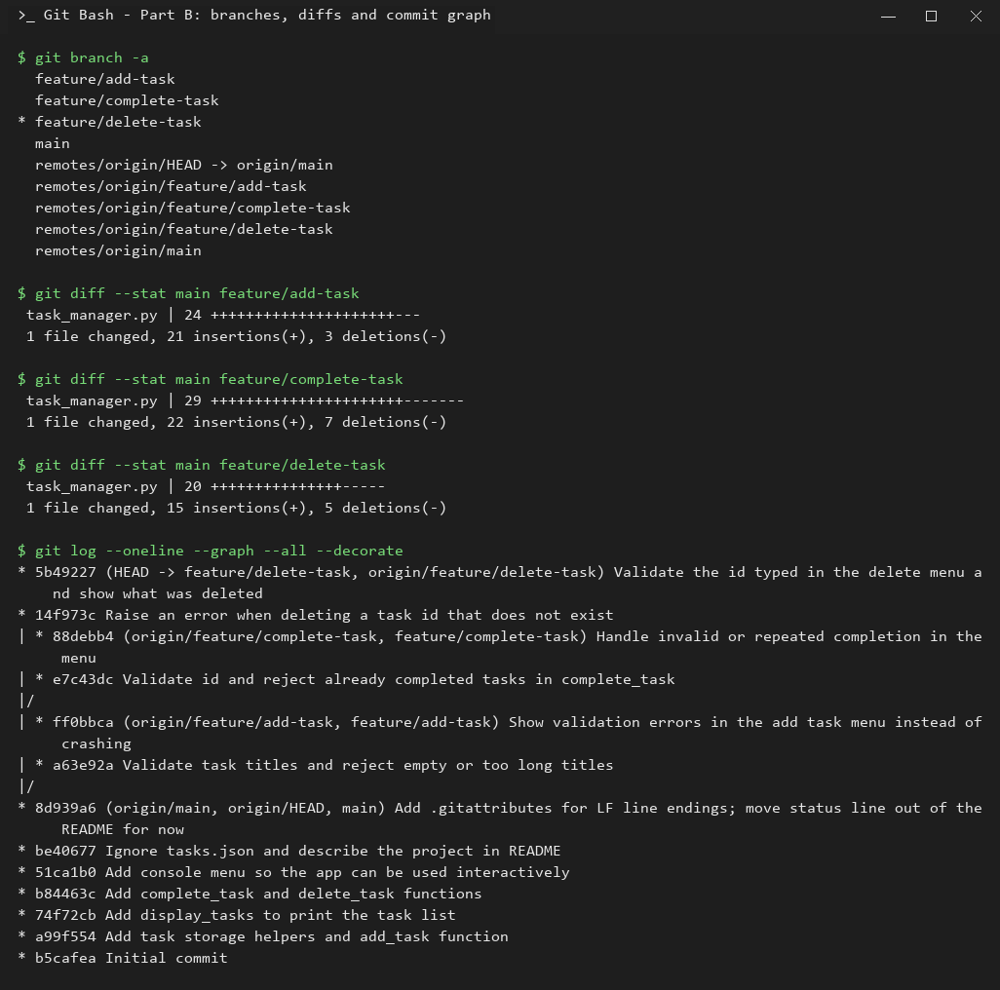
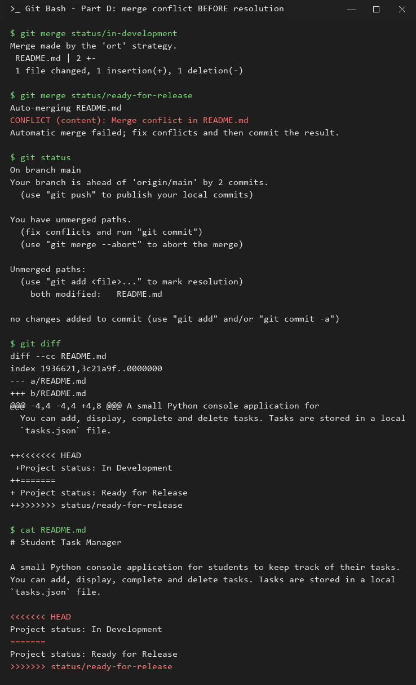
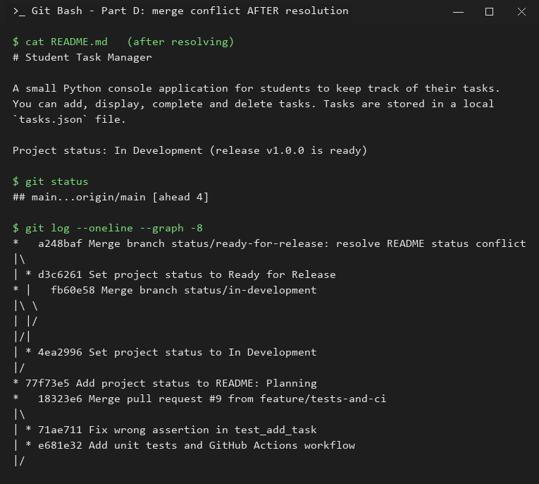
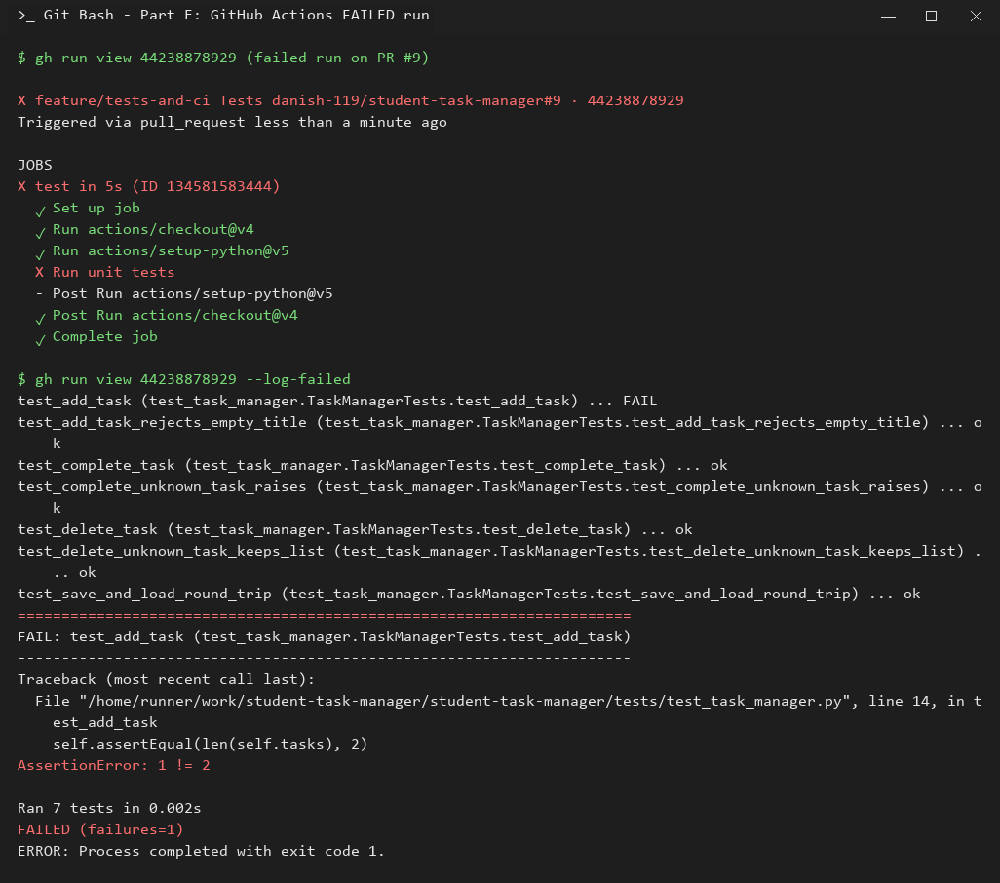
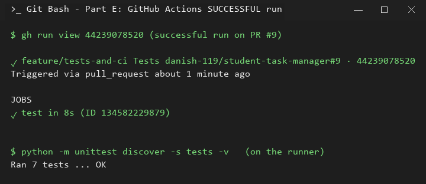

# Lab Assignment 4 - Report

Student Task Manager: development and version control with Git and GitHub.
Repository: https://github.com/danish-119/student-task-manager

## Part A - Repository setup and version control

- Repository `student-task-manager` created with `README.md`, a Python `.gitignore` and the MIT license.
- Cloned locally and configured with `git config user.name` / `user.email`.
- The console app (`task_manager.py`) was built in small commits: storage helpers and `add_task`,
  `display_tasks`, `complete_task` and `delete_task`, then the interactive menu, then README and `.gitignore` updates.
- Commands used: `git status`, `git add`, `git commit`, `git diff`, `git log`, `git push`, `git pull`.

## Part B - Branching and feature development

| Branch | Purpose | Commits |
| ------ | ------- | ------- |
| `feature/add-task` | Validate input and reject empty titles | 2 |
| `feature/complete-task` | Mark selected tasks as completed | 2 |
| `feature/delete-task` | Delete tasks using a valid identifier | 2 |

All branches were pushed to GitHub. Comparison and graph:

**Why branches are useful.** A branch is an isolated line of development. Each feature
(validation, completing, deleting) could be written and tested on its own without
breaking `main`, which always stays in a working state. Branches let several people (or
several tasks) progress in parallel, keep each change small and easy to review through
a pull request, and make it simple to discard or revert an idea. Because they are
merged back only after review and passing tests, the history shows clearly which
commits belong to which feature.

## Part C - Issues and pull requests

| Issue | Labels |
| ----- | ------ |
| #1 Validate input and reject empty task titles | enhancement, validation |
| #2 Mark selected tasks as completed | enhancement |
| #3 Delete tasks using a valid task identifier | enhancement, validation |
| #4 Write README and user guide | documentation |
| #5 Add unit tests and a GitHub Actions workflow | testing, enhancement |

| Pull request | Closes | Review |
| ------------ | ------ | ------ |
| #6 `feature/add-task` | #1 | review comment added, merged |
| #7 `feature/complete-task` | #2 | review comment added, merged |
| #8 `feature/delete-task` | #3 | review comment added, merged |
| #9 `feature/tests-and-ci` | #5 | review comment added, merged |
| docs PR `docs/readme-and-user-guide` | #4 | review comment added, merged |

For each pull request the changed files were reviewed (`gh pr diff`), a review comment was
added, and the PR was merged with a merge commit so the branch history stays visible.

## Part D - Merge conflict

1. `Project status: Planning` was added to `README.md` on `main` and committed.
2. Two branches were created from that commit: `status/in-development` (changed the line to
   `Project status: In Development`) and `status/ready-for-release` (changed it to
   `Project status: Ready for Release`).
3. `status/in-development` merged cleanly into `main`. Merging `status/ready-for-release`
   then failed with a conflict.

Before resolution (conflict markers in `README.md`):

After resolution (markers removed, other README content untouched, merge committed):

**What caused the conflict.** Both branches started from the same commit and both
modified the *same line* of the *same file* in different ways. The first merge
simply moved `main` forward. For the second merge Git found that the line had been
changed on `main` (by the first branch) and also on the second branch, relative to
their common ancestor, and it cannot decide automatically which version is correct. It
therefore stopped and wrote both versions between `<<<<<<<`, `=======` and `>>>>>>>`
markers. The resolution kept one combined line, `Project status: In Development (release
v1.0.0 is ready)`, and no unrelated content was removed.

## Part E - GitHub Actions and testing

- `tests/test_task_manager.py` contains seven `unittest` tests, including the required ones:
  adding a task, marking a task complete and deleting a task.
- `.github/workflows/tests.yml` runs `python -m unittest discover -s tests -v` on push to
  `main` and on pull requests to `main`.
- The first push of PR #9 contained a deliberately wrong assertion to show a failed run.
  A follow-up commit fixed it and the run passed.

Failed run: https://github.com/danish-119/student-task-manager/actions/runs/44238878929

Successful run: https://github.com/danish-119/student-task-manager/actions/runs/44239078520

## Part F - Documentation and release

- `README.md` lists features, setup, usage and test instructions.
- `docs/user-guide.md` is a short user guide.
- GitHub Release `v1.0.0` was created with release notes.

## Note on the screenshots

The images above are renderings of the real terminal output (`git` and `gh` commands)
captured while doing the assignment. The GitHub web pages for the same runs, pull
requests and issues are linked in this report.
